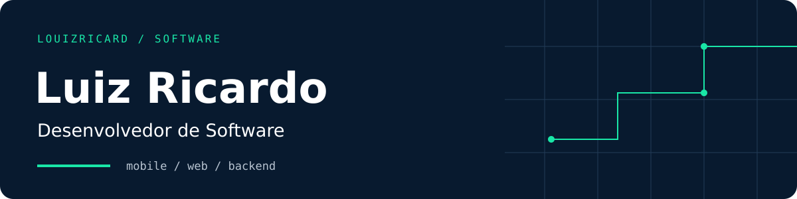
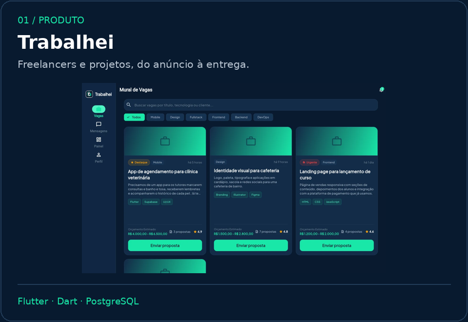
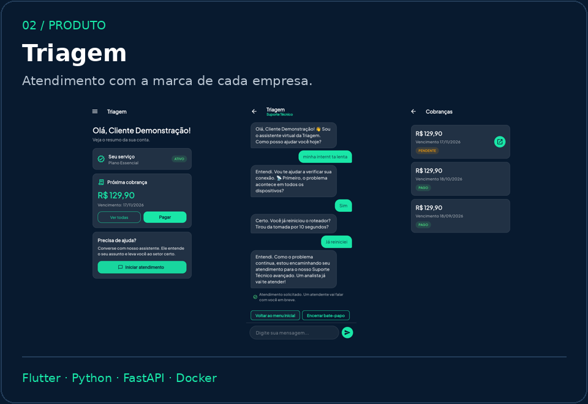
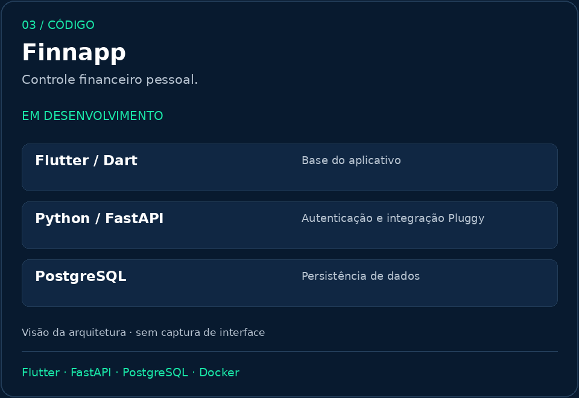
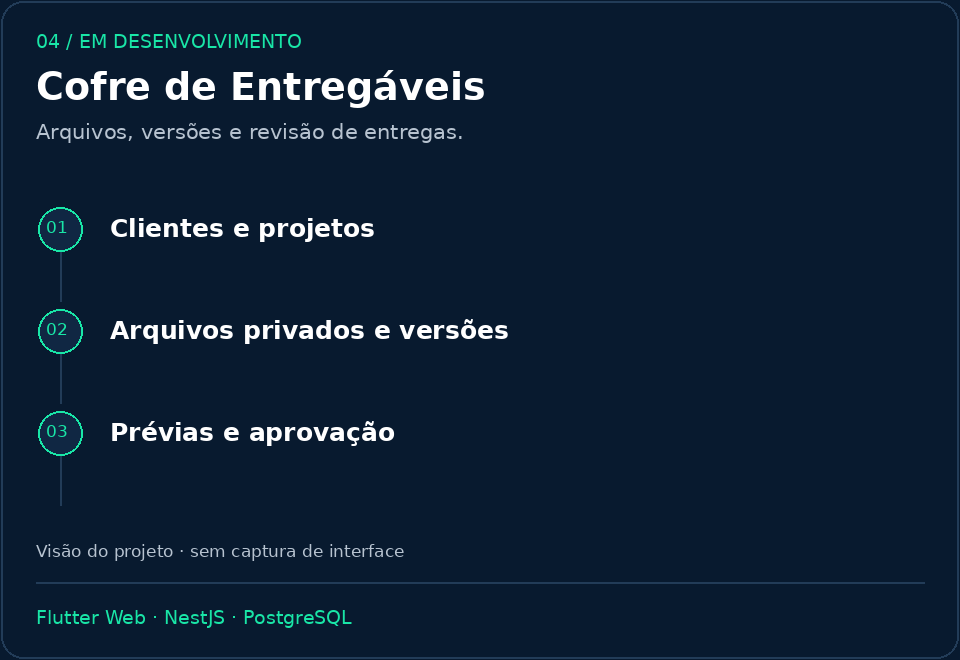

<p align="center">
  <picture>
    <source media="(max-width: 600px)" srcset="assets/banner-mobile.svg">
    
  </picture>
</p>

<p align="center">
  
</p>

Faço apps com Flutter e APIs com Python. Gosto de entender o problema, organizar as regras e construir algo que faça sentido usar. Estudo Engenharia de Software e também crio jogos nas horas vagas.

[LinkedIn](https://www.linkedin.com/in/luiz-ricardo-32249a332/) · [Portfólio](https://louizvolution.vercel.app/) · [Jogos no itch.io](https://louizvolution.itch.io/)

### Projetos

<p>
  <a href="https://github.com/Louizricard/Trabalhei"></a>
  <a href="https://github.com/Louizricard/triagem-demo"></a>
</p>
<p>
  <a href="https://github.com/Louizricard/Finnapp"></a>
  <a href="https://github.com/Louizricard/cofre-entregaveis"></a>
</p>

[**Trabalhei**](https://trabalhei.site) — freelancers, propostas e entregas.<br>
[**Triagem**](https://github.com/Louizricard/triagem-demo) — assistente de atendimento configurável por empresa.<br>
[**Finnapp**](https://github.com/Louizricard/Finnapp) — controle financeiro pessoal, em desenvolvimento.<br>
[**Cofre de Entregáveis**](https://github.com/Louizricard/cofre-entregaveis) — arquivos e revisão de entregas, **em desenvolvimento**.

<sub>Trabalhei e Triagem: capturas reais com dados de demonstração. Triagem: apresentação pública; código proprietário.</sub>

### Stack

<picture>
  <source media="(max-width: 600px)" srcset="assets/stack-mobile.svg">
  
</picture>

Também uso TypeScript, NestJS, Supabase, Astro e GitHub Actions.

```text
louiz@dev:~$ cat foco.txt
apps, APIs e regras de negócio
construir → testar → melhorar
```

### Por aqui

<a href="https://github.com/Louizricard?tab=repositories">
  <picture>
    <source media="(max-width: 600px)" srcset="assets/stats-mobile.svg">
    
  </picture>
</a>


<sub>Estatísticas e snake atualizadas diariamente pelo [GitHub Actions](https://github.com/Louizricard/Louizricard/actions/workflows/profile.yml).</sub>
